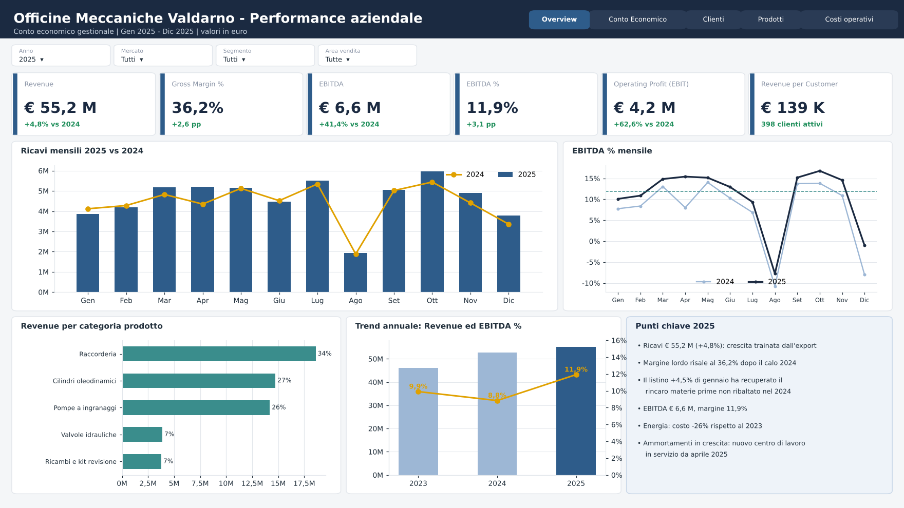
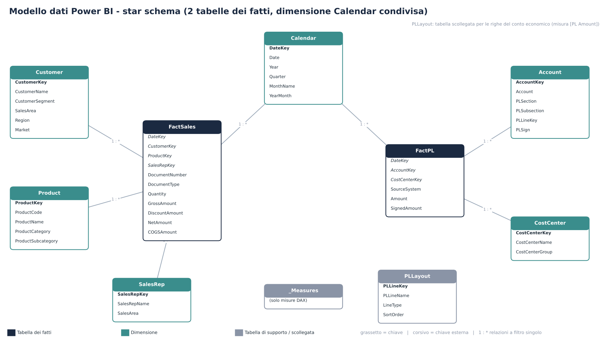
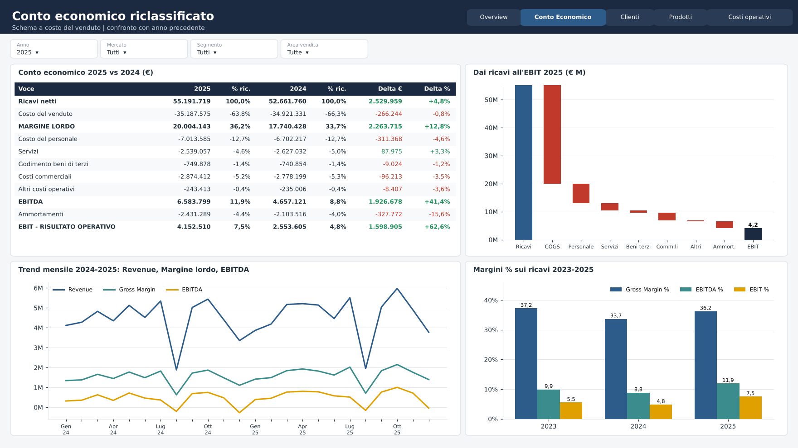
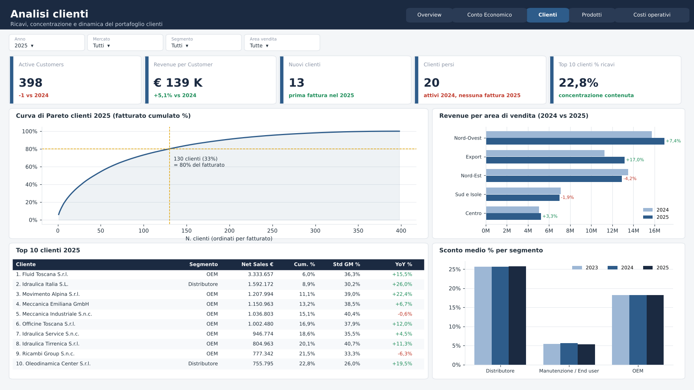
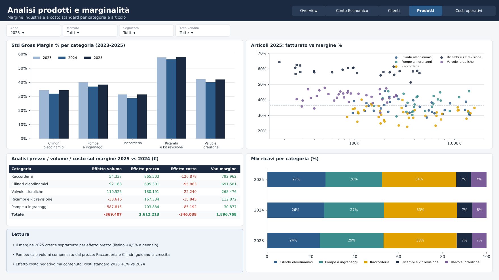
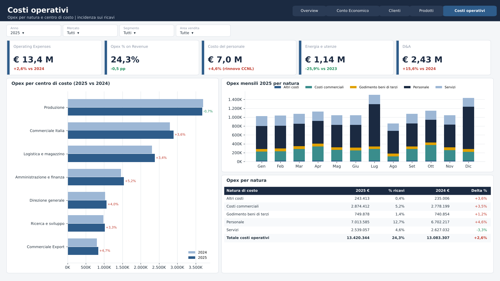

# Dashboard Conto Economico e Performance Aziendale

**SQL Server · Power BI · DAX · Power Query · Python (generazione dati)**

Dashboard di controllo di gestione per un'azienda manifatturiera italiana di medie dimensioni: conto economico riclassificato, marginalità per prodotto e cliente, costi operativi per centro di costo, confronto con l'anno precedente.

L'azienda (Officine Meccaniche Valdarno S.p.A., componenti oleodinamici) è inventata e i dati sono simulati, ma ho cercato di costruirli come li troverei in un'azienda vera: fatture e note di credito riga per riga, sconti diversi per tipo di cliente, stagionalità con agosto quasi fermo, rincaro delle materie prime nel 2024 non ribaltato subito sui listini, tredicesima e quattordicesima nel costo del personale, calo dei costi energetici dopo il 2023.



---

## Executive summary

| | 2023 | 2024 | 2025 |
|---|---:|---:|---:|
| Ricavi netti | 46,1 M€ | 52,7 M€ | 55,2 M€ |
| Crescita YoY | - | +14,2% | +4,8% |
| Gross Margin % | 37,2% | 33,7% | 36,2% |
| EBITDA | 4,6 M€ | 4,7 M€ | 6,6 M€ |
| EBITDA % | 9,9% | 8,8% | 11,9% |
| Operating Profit (EBIT) | 2,5 M€ | 2,6 M€ | 4,2 M€ |

In sintesi: il 2024 è stato un anno di forte crescita dei volumi ma con margini in calo, perché i costi standard sono saliti del 7% mentre il listino è stato ritoccato solo del 3% (e da marzo). Nel 2025 l'aumento di listino del 4,5% ha recuperato il margine e l'EBITDA è cresciuto del 41% con ricavi in crescita "solo" del 4,8%.

## Il problema di business

Il controllo di gestione chiudeva il mese con un file Excel alimentato a mano da tre estrazioni diverse (vendite, contabilità, anagrafiche). Risultato:

- il conto economico gestionale arrivava alla direzione dopo 10-12 giorni dalla chiusura;
- nessuno riusciva a dire con certezza *perché* il margine 2024 fosse sceso: prezzi, volumi, mix o costi?
- l'analisi per cliente e per prodotto si faceva solo su richiesta, a parte.

Obiettivi del progetto:

1. un unico modello dati con vendite e contabilità che quadrino tra loro;
2. conto economico riclassificato a costo del venduto, mensile, con confronto anno precedente;
3. monitoraggio di fatturato, costi, margine lordo, EBITDA e risultato operativo con trend mensili;
4. analisi di marginalità per categoria prodotto e concentrazione clienti.

## KPI

| KPI | Definizione | Misura DAX |
|---|---|---|
| Revenue | Ricavi netti (fatture - note di credito) | `[Revenue]` |
| Cost of Goods Sold | Costo standard del venduto + varianze di produzione | `[COGS]` |
| Gross Margin % | (Revenue - COGS) / Revenue | `[Gross Margin %]` |
| EBITDA | Margine lordo - costi operativi | `[EBITDA]` |
| EBITDA % | EBITDA / Revenue | `[EBITDA %]` |
| Operating Profit | EBITDA - ammortamenti | `[Operating Profit]` |
| YoY Growth | Ricavi periodo vs stesso periodo anno precedente | `[YoY Growth %]` |
| Revenue per Customer | Ricavi / clienti con almeno una fattura nel periodo | `[Revenue per Customer]` |
| Revenue per Product Category | Ricavi e peso % per categoria | `[Net Sales]`, `[Revenue Share by Category %]` |

Più alcune misure di supporto: ricavi YTD e ultimi 12 mesi, nuovi clienti / clienti persi, quota top 10 clienti, curva di Pareto, sconto medio, incidenza note di credito.

## Struttura del repository

```
pl-performance-dashboard/
├── data/                  estratti CSV (formato "ERP")
├── python/
│   └── generate_data.py   generazione del dataset simulato (seed fisso)
├── sql/
│   ├── 01_create_database_and_tables.sql
│   ├── 02_populate_dim_date.sql
│   ├── 03_load_staging.sql
│   ├── 04_load_dw.sql
│   ├── 05_reporting_views.sql
│   ├── 06_analysis_queries.sql
│   └── 07_data_quality_checks.sql
├── powerbi/
│   ├── measures.dax       tutte le misure, commentate
│   └── power_query.m      query M e parametri
├── docs/
│   ├── data_dictionary.md
│   └── dashboard_layout.md
└── images/
```

## Dataset

| File | Righe | Contenuto |
|---|---:|---|
| sales_invoice_lines.csv | 86.085 | righe fattura e note di credito 2023-2025 (~40.000 documenti) |
| gl_entries.csv | 3.281 | registrazioni di contabilità generale: costi operativi, varianze, ammortamenti |
| customers.csv | 430 | clienti Italia ed export, segmento, area, agente, condizioni di pagamento |
| products.csv | 154 | articoli in 5 categorie con prezzo di listino e costo standard |
| sales_reps.csv | 10 | agenti / area manager |
| chart_of_accounts.csv | 14 | piano dei conti gestionale con mappatura al CE riclassificato |
| cost_centers.csv | 7 | centri di costo |

Totale: circa 90.000 record. Il dataset si rigenera con `python python/generate_data.py` (numpy + pandas). Le regole principali che ho messo nel generatore:

- **clienti** con distribuzione del fatturato concentrata (circa un terzo dei clienti fa l'80% dei ricavi), alcuni persi e alcuni acquisiti nel periodo;
- **sconti** per segmento: distributori 25-26%, OEM 18%, manutentori/end user 5%;
- **prezzi e costi**: costo standard +7% nel 2024 e +1% nel 2025, listino +3% da marzo 2024 e +4,5% da gennaio 2025;
- **note di credito** circa 1,5% dei documenti;
- **costi operativi** con logiche diverse per natura (personale con mensilità aggiuntive a luglio e dicembre, energia in calo dal picco 2023, fiere ad aprile e ottobre, trasporti e provvigioni legati al fatturato).

## Database SQL Server

Tre schemi: `stg` (copia grezza dei CSV, tutto testo), `dw` (modello a stella con chiavi surrogate, FK, indici columnstore sui fatti) e `rpt` (viste lette da Power BI).

Scelte che vale la pena spiegare:

- **Due tabelle dei fatti.** `FactSales` ha il dettaglio riga fattura e serve per clienti e prodotti; `FactPL` ha il grain giorno × conto × centro di costo e contiene sia ricavi/COGS (sintetizzati da FactSales) sia i costi di contabilità. In questo modo il conto economico si legge da un'unica tabella e le analisi commerciali non si appesantiscono con i costi.
- **Segno dei valori.** `Amount` è in segno naturale (costi positivi), `SignedAmount` ha il segno da conto economico. I subtotali del CE diventano una semplice somma delle righe precedenti.
- **Membro "non definito" (-1)** su clienti e prodotti, per non perdere fatturato se arriva un codice non ancora in anagrafica.
- **Procedura di caricamento** `dw.usp_LoadPL` in transazione unica con `TRY/CATCH`: o carica tutto o niente.
- **Quadrature** nello script 07: ricavi staging = FactSales = FactPL, totale costi staging = FactPL, controllo duplicati, vendite sottocosto, mesi senza cedolini o ammortamenti.

Ordine di esecuzione: script da 01 a 05 (nel 03 va impostato il percorso della cartella `data`), poi 07 per i controlli.

## Modello Power BI



- Star schema con `Calendar` condivisa dalle due tabelle dei fatti, relazioni 1:* a filtro singolo, tabella `Calendar` contrassegnata come tabella data.
- `PLLayout` è scollegata: contiene le righe del conto economico (dettagli e subtotali) e la misura `[PL Amount]` decide cosa calcolare per ogni riga. È il modo più pulito che ho trovato per avere Margine lordo, EBITDA ed EBIT dentro la stessa matrice senza colonne calcolate.
- Tutte le misure stanno nella tabella `_Measures`, divise in cartelle (P&L, Conto economico, Time intelligence, Vendite, Clienti, Prodotti, UI).
- Power Query legge solo le viste `rpt` tramite una funzione `fnGetView` e due parametri (server, database), quindi il query folding resta completo e cambiare ambiente richiede un clic.

Alcune misure, spiegate più nel dettaglio dentro `measures.dax`:

```dax
PL Amount =
VAR _Line = SELECTEDVALUE ( PLLayout[PLLineKey] )
VAR _Type = SELECTEDVALUE ( PLLayout[LineType] )
RETURN
    SWITCH (
        TRUE (),
        _Type = "Detail",   CALCULATE ( SUM ( FactPL[SignedAmount] ), Account[PLLineKey] = _Line ),
        _Type = "Subtotal", CALCULATE ( SUM ( FactPL[SignedAmount] ), Account[PLLineKey] < _Line ),
        BLANK ()
    )
```

```dax
YoY Growth % =
VAR _PY = [Revenue PY]
RETURN IF ( NOT ISBLANK ( _PY ), DIVIDE ( [Revenue] - _PY, _PY ) )
```

```dax
New Customers =
VAR _Start = MIN ( 'Calendar'[Date] )
VAR _CustomersInPeriod =
    CALCULATETABLE ( VALUES ( FactSales[CustomerKey] ), FactSales[DocumentType] = "FT" )
VAR _CustomersBefore =
    CALCULATETABLE (
        VALUES ( FactSales[CustomerKey] ),
        FactSales[DocumentType] = "FT",
        'Calendar'[Date] < _Start,
        REMOVEFILTERS ( 'Calendar' )
    )
RETURN COUNTROWS ( EXCEPT ( _CustomersInPeriod, _CustomersBefore ) )
```

## Dashboard

Cinque pagine, filtri comuni su anno, mercato, segmento e area (sincronizzati tra le pagine). Layout e dettaglio dei visual in [docs/dashboard_layout.md](docs/dashboard_layout.md). Le immagini qui sotto sono i mockup delle pagine, costruiti con i dati del progetto.

| Pagina | Contenuto |
|---|---|
| Overview | KPI principali con variazione vs anno precedente, ricavi mensili vs anno precedente, EBITDA % mensile, ricavi per categoria, trend 3 anni |
| Conto Economico | matrice CE riclassificato con % sui ricavi e delta vs anno precedente, trend mensile, waterfall ricavi → EBIT |
| Clienti | clienti attivi, nuovi e persi, ricavo medio per cliente, curva di Pareto, top 10, ricavi per area, sconto medio per segmento |
| Prodotti | margine standard per categoria, scatter articoli fatturato/margine, analisi prezzo-volume-costo, mix |
| Costi operativi | opex per centro di costo e per natura, incidenza sui ricavi, andamento mensile |









Palette: blu notte `#1B2A41` (intestazioni, valori principali), blu `#2E5C8A` (serie anno corrente), azzurro `#9DB7D5` (anno precedente), verde petrolio `#3A8D8C`, ambra `#E0A100` (linee di confronto e target), verde `#1E8E5A` / rosso `#C0392B` solo per variazioni positive e negative, sfondo `#F4F6F8`.

## Cosa emerge dai dati

1. **Il calo di margine 2024 è un problema di prezzo, non di volumi.** I ricavi sono cresciuti del 14%, ma il costo standard è salito del 7% contro un +3% di listino applicato da marzo: il margine lordo è sceso dal 37,2% al 33,7%. Nel 2025 l'aumento di listino del 4,5% ha riportato il margine al 36,2%.
2. **L'analisi prezzo-volume-costo 2025 vs 2024** mostra che il margine industriale è cresciuto di circa 1,9 M€: +2,6 M€ di effetto prezzo, -0,35 M€ di effetto costo e -0,37 M€ di effetto volume. Le pompe hanno perso volumi (-0,59 M€ di margine) ma il prezzo ha compensato.
3. **L'export è il motore della crescita**: +17% nel 2025, ormai al 24% dei ricavi. Nord-Est in calo del 4%, da approfondire con l'area manager.
4. **Concentrazione clienti sotto controllo**: i primi 10 clienti pesano il 23% dei ricavi, 130 clienti su 398 fanno l'80% del fatturato. Nel 2025 però i clienti persi (20) superano i nuovi (13).
5. **Ricambi e kit revisione** hanno il margine più alto (58%) ma pesano solo il 7% dei ricavi: è la leva più interessante per migliorare il mix.
6. **Costi operativi**: incidenza sui ricavi in calo al 24,3%. Il personale cresce del 4,6% (rinnovo CCNL metalmeccanici), l'energia è scesa del 26% rispetto al 2023. Gli ammortamenti salgono del 16% per il nuovo centro di lavoro entrato in funzione ad aprile 2025.

## Limiti e possibili sviluppi

- Il perimetro si ferma al risultato operativo: mancano gestione finanziaria e imposte.
- Il costo del venduto è a costo standard + varianze totali; con i dati di produzione si potrebbero separare varianze di prezzo, di efficienza e di volume.
- Il prossimo passo sarebbe aggiungere budget e forecast per confrontare il consuntivo anche con gli obiettivi (lo faccio nel progetto [Budget vs Consuntivo](https://github.com/andreapollastrelli95/budget-vs-actual)).
- Un refresh incrementale su `FactSales` avrebbe senso con volumi reali più grandi.

## Come riprodurre

1. `pip install pandas numpy` e `python python/generate_data.py` (opzionale, i CSV sono già nella cartella `data`).
2. Eseguire in SSMS gli script SQL in ordine, impostando `@DataPath` nello script 03.
3. In Power BI Desktop: creare i parametri `ServerName` e `DatabaseName`, incollare le query da `powerbi/power_query.m`, creare le relazioni come nello schema e le misure da `powerbi/measures.dax`.

---

Andrea Pollastrelli · [Portfolio](https://andreapollastrelli95.github.io/)

Dati interamente simulati: nomi di aziende e persone sono di fantasia.
